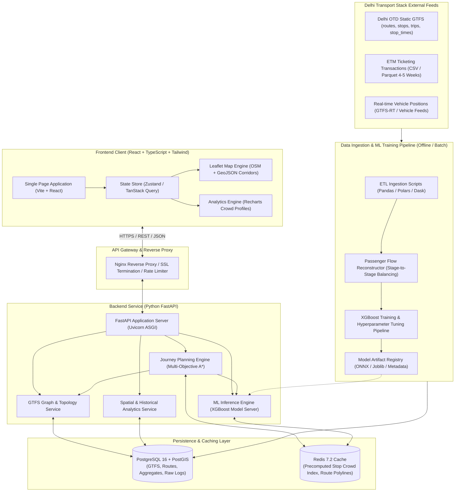
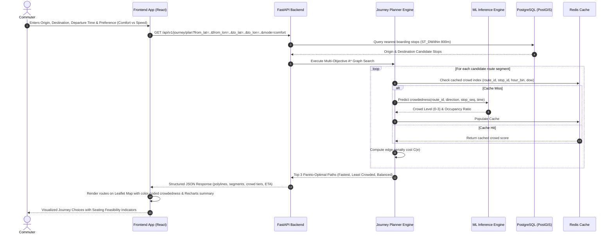

# TransitSense AI: System Architecture Document
**Transport Stack Hackathon 2026 — Problem 2: Crowdedness-Aware Journey Planner**  
**Author:** Chief Software Architect & Technical Lead  
**Document Version:** 1.0.0  
**Target City:** National Capital Territory of Delhi (DTC & DIMTS Transit Network)

---

## 1. Executive Summary & Problem Context

TransitSense AI is an intelligent, multi-objective public transport journey planner engineered specifically for Delhi's bus network. In Delhi, over 4.2 million passenger trips are serviced daily across more than 500 routes operated by the Delhi Transport Corporation (DTC) and Delhi Integrated Multi-Modal Transit System (DIMTS). While transit applications conventionally optimize solely for travel duration and transit interchange count, commuter surveys show that **crowdedness, physical safety, and boarding feasibility (preventing crush-loads)** are decisive factors in modal choice.

TransitSense AI leverages the official **Delhi Transport Stack** (open transit data layers comprising static GTFS, live GPS streams, and Electronic Ticketing Machine [ETM] transaction logs) to:
1. Reconstruct historical segment-by-segment passenger loads across route stages.
2. Train gradient-boosted machine learning models (XGBoost) to predict real-time and scheduled crowdedness levels.
3. Integrate dynamic crowdedness penalties into a Pareto-optimal journey planning engine ($A^*$ / Multi-Objective Dijkstra), allowing commuters to choose between the fastest route, the most comfortable (least crowded) route, or a balanced compromise.

---

## 2. High-Level Architecture (C4 Container Diagram)

---

## 3. Core Subsystems & Components

### 3.1 Data Ingestion & Flow Reconciliation Subsystem
- **Input:** 4 to 5 weeks of Electronic Ticketing Machine (ETM) CSV/Parquet transaction dumps provided by the Delhi Transport Stack hackathon portal alongside static GTFS feeds.
- **Normalization:** Cleans invalid stops, reconciles stage names with GTFS `stop_id` records, and handles female commuter zero-fare tickets ("Pink Tickets" under Delhi Government's concession scheme, which account for ~35–45% of total ridership).
- **Flow Conservation:** Solves the boarding-alighting occupancy equation across sequential stops for each observed trip:
  $$\text{Load}_{s} = \text{Load}_{s-1} + \text{Boardings}_{s} - \text{Alightings}_{s}$$
- **Aggregation:** Emits aggregated stop-pair, hourly, and day-of-week occupancy matrices stored in PostgreSQL tables partitioned by week.

### 3.2 Machine Learning Inference Subsystem
- **Model Framework:** Optimized XGBoost regressor (for passenger load) paired with a calibrated multi-class classifier for crowdedness tier prediction:
  - **Tier 0 (Low):** $\le 50\%$ vehicle capacity (Guaranteed seating).
  - **Tier 1 (Moderate):** $51\% - 80\%$ vehicle capacity (Few seats, comfortable standing).
  - **Tier 2 (High):** $81\% - 100\%$ vehicle capacity (Dense standing, limited boarding room).
  - **Tier 3 (Crush / Severe):** $> 100\%$ nominal capacity (Overcrowded, boarding failures likely).
- **Latency Guarantee:** Model artifacts exported to optimized runtimes (or vectorized NumPy tree evaluation) yielding sub-10ms inference per trip route request.
- **Warm Cache:** Pre-computes peak-hour historical indices and stores them in Redis to serve instant evaluations during pathfinding iterations.

### 3.3 Journey Planning Subsystem (Multi-Objective $A^*$)
- **Transit Network Graph:** Direct Directed Acyclic Graphs (DAGs) constructed from GTFS trip schedules, where nodes represent $(stop\_id, time)$ arrival states, and directed edges represent either:
  1. **In-Vehicle Transit Legs:** Moving from stop $i$ to $j$ on route $R$.
  2. **Interchange Transfers:** Walking between nearby stops (distance $\le 400$ meters) or wait times for connecting lines.
- **Cost Formulation:** The traversal cost of an edge $e$ is a parameterized utility function:
  $$C(e) = w_{\text{time}} \cdot T_{\text{travel}}(e) + w_{\text{crowd}} \cdot \Phi(\text{CrowdLevel}(e)) + w_{\text{trans}} \cdot I_{\text{transfer}} + w_{\text{walk}} \cdot T_{\text{walk}}(e)$$
  where $\Phi(\text{CrowdLevel})$ is a non-linear convex penalty function:
  $$\Phi(\text{Low}) = 0, \quad \Phi(\text{Moderate}) = 1.2, \quad \Phi(\text{High}) = 3.5, \quad \Phi(\text{Crush}) = 8.0$$
- **Preset User Profiles:**
  - *Speed First:* $w_{\text{time}} = 1.0, w_{\text{crowd}} = 0.1, w_{\text{trans}} = 1.0$
  - *Comfort First (Crowd-Averse):* $w_{\text{time}} = 0.6, w_{\text{crowd}} = 1.5, w_{\text{trans}} = 0.8$
  - *Balanced:* $w_{\text{time}} = 1.0, w_{\text{crowd}} = 0.8, w_{\text{trans}} = 1.0$

### 3.4 Backend Presentation Subsystem (FastAPI)
- Exposes structured RESTful endpoints with automatic OpenAPI documentation.
- Handles spatial queries (e.g., nearest bus stop within radius $r$ using PostGIS `ST_DWithin`).
- Generates stop-level crowdedness profiles for visual rendering in the client dashboard.

### 3.5 Frontend Subsystem (React + TypeScript + Leaflet)
- Responsive layout built with Tailwind CSS, supporting desktop and mobile devices.
- **Map View:** Leaflet interactive map rendering Delhi road corridors, route polylines colored dynamically by predicted crowdedness (Green, Yellow, Orange, Red), and animated bus markers.
- **Itinerary Card:** Side-by-side comparison of alternative routes highlighting travel duration, walking distance, number of interchanges, and crowd factor badges.
- **Stop Analytics Drawer:** Uses Recharts to visualize the 24-hour temporal crowdedness curve for any selected stop or route stage.

---

## 4. End-to-End Data Flow

---

## 5. Technology Stack Justification & Compatibility Matrix

| Layer | Component | Selected Technology | Rationale & Justification |
| :--- | :--- | :--- | :--- |
| **Frontend Framework** | UI Core | **React 18 + TypeScript** | Strict type safety for complex GTFS & itinerary models; reactive state management. |
| **Styling** | CSS Design System | **Tailwind CSS** | High-velocity styling with responsive design tokens and utility-first transit UI cards. |
| **Mapping Engine** | Geospatial Client | **Leaflet + OpenStreetMap** | Lightweight, open-source, zero API-key dependencies, native GeoJSON polyline and marker support. |
| **Visualization** | Charts & Profiles | **Recharts** | Declarative, SVG-based charting optimized for React; renders stop-level load curves smoothly. |
| **Backend Framework** | Web Server | **Python FastAPI (3.11+)** | High throughput ASGI server, automatic Pydantic data validation, native async IO, and seamless integration with Python ML libraries. |
| **Machine Learning** | Model Training | **Pandas, NumPy, Scikit-learn, XGBoost** | Industry standard for tabular transit data; handles non-linear interactions between routes, times, and day-of-week with superior accuracy and fast inference. |
| **Database** | Relational & Geospatial | **PostgreSQL 16 + PostGIS** | Relational integrity for GTFS transit tables; PostGIS indexed spatial lookups (`ST_Distance`, `ST_DWithin`). |
| **In-Memory Cache** | Low-latency Key-Value | **Redis 7.2** | Sub-millisecond lookup of precomputed stop crowdedness scores to keep journey planning routing latency $< 150\text{ms}$. |

---

## 6. Non-Functional Requirements & System Guarantees

1. **Inference & Routing Latency:** 
   - A multi-stop journey plan across Delhi's transit network must return within $\le 300\text{ms}$ for standard queries.
   - Stop-level crowd lookups must resolve in $\le 30\text{ms}$.
2. **Data Authenticity:**
   - Zero fabrication of passenger counts. All crowd inferences must be statistically anchored to Delhi Transport Stack ETM and GTFS records.
3. **Graceful Degradation:**
   - If real-time or machine learning inference is unavailable for an infrequent route, the system falls back to historical empirical average stage-load baseline tables without failing the user journey request.
4. **Resilience & Scalability:**
   - Stateless backend containers capable of horizontal scaling behind Nginx load balancers.
   - Read-heavy queries served from indexed materialized views and Redis caches.
