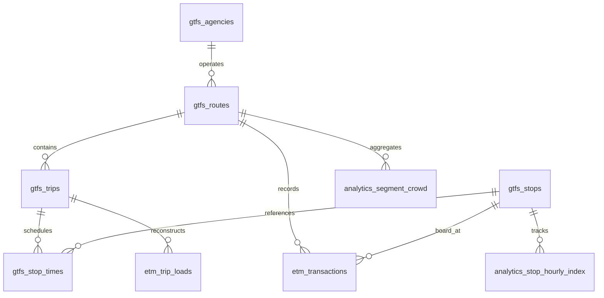

# TransitSense AI: Database Schema Specification
**Transport Stack Hackathon 2026 — Problem 2: Crowdedness-Aware Journey Planner**  
**Database Engine:** PostgreSQL 16 with PostGIS 3.4 Extension  
**Document Version:** 1.0.0  

---

## 1. Schema Architecture Overview

The database is structured into four primary logical namespaces/domains:
1. **GTFS Core (`gtfs_*`):** Standardized public transit network definitions (agencies, routes, stops, trips, schedules, geometries) derived from the Delhi Transport Stack Open Transit Data portal.
2. **ETM & Ticketing Operations (`etm_*`):** High-throughput transaction tables storing raw and cleaned Electronic Ticketing Machine records, female passenger concession passes ("Pink Tickets"), and reconstructed passenger boardings/alightings.
3. **ML Feature & Crowdedness Aggregates (`analytics_*`, `ml_*`):** Precomputed historical hourly occupancy distributions, model inference caches, and segment load statistics.
4. **Application Logging & Queries (`app_*`):** Session logging for search performance monitoring and commuter journey feedback.



---

## 2. Spatial & Extension Initialization

```sql
-- Ensure required spatial and analytical extensions are active
CREATE EXTENSION IF NOT EXISTS postgis;
CREATE EXTENSION IF NOT EXISTS "uuid-ossp";
CREATE EXTENSION IF NOT EXISTS btree_gist;
```

---

## 3. GTFS Core Schema (Network Topology)

### 3.1 `gtfs_agencies`
Stores transit operator metadata (e.g., Delhi Transport Corporation - DTC, Delhi Integrated Multi-Modal Transit System - DIMTS).

```sql
CREATE TABLE gtfs_agencies (
    agency_id VARCHAR(32) PRIMARY KEY,
    agency_name VARCHAR(128) NOT NULL,
    agency_url VARCHAR(255),
    agency_timezone VARCHAR(64) DEFAULT 'Asia/Kolkata',
    agency_lang VARCHAR(10) DEFAULT 'en',
    agency_phone VARCHAR(32)
);

INSERT INTO gtfs_agencies (agency_id, agency_name, agency_url)
VALUES 
    ('DTC', 'Delhi Transport Corporation', 'https://dtc.delhi.gov.in'),
    ('DIMTS', 'Delhi Integrated Multi-Modal Transit System Ltd.', 'https://dimts.in');
```

### 3.2 `gtfs_routes`
Captures route definitions across Delhi corridors.

```sql
CREATE TABLE gtfs_routes (
    route_id VARCHAR(64) PRIMARY KEY,
    agency_id VARCHAR(32) REFERENCES gtfs_agencies(agency_id) ON DELETE CASCADE,
    route_short_name VARCHAR(64) NOT NULL, -- e.g., '534', '764', 'CBD-1'
    route_long_name VARCHAR(255) NOT NULL,  -- e.g., 'Anand Vihar ISBT to Mehrauli'
    route_desc TEXT,
    route_type INT NOT NULL DEFAULT 3,      -- 3 = Bus in GTFS spec
    route_color VARCHAR(10),                -- Hex code for frontend rendering
    route_text_color VARCHAR(10),
    is_ac BOOLEAN DEFAULT FALSE,            -- AC vs Non-AC bus route
    created_at TIMESTAMP WITH TIME ZONE DEFAULT CURRENT_TIMESTAMP
);

CREATE INDEX idx_gtfs_routes_short_name ON gtfs_routes(route_short_name);
CREATE INDEX idx_gtfs_routes_agency ON gtfs_routes(agency_id);
```

### 3.3 `gtfs_stops`
Georeferenced bus stops across the National Capital Territory of Delhi.

```sql
CREATE TABLE gtfs_stops (
    stop_id VARCHAR(64) PRIMARY KEY,
    stop_code VARCHAR(32),
    stop_name VARCHAR(255) NOT NULL,
    stop_desc TEXT,
    stop_lat NUMERIC(9, 6) NOT NULL,
    stop_lon NUMERIC(9, 6) NOT NULL,
    geom GEOMETRY(Point, 4326) GENERATED ALWAYS AS (ST_SetSRID(ST_MakePoint(stop_lon, stop_lat), 4326)) STORED,
    zone_id VARCHAR(64),
    wheelchair_boarding INT DEFAULT 0
);

-- Spatial index for sub-millisecond proximity queries
CREATE INDEX idx_gtfs_stops_geom ON gtfs_stops USING GIST (geom);
CREATE INDEX idx_gtfs_stops_name_trgm ON gtfs_stops USING gin (stop_name gin_trgm_ops);
```

### 3.4 `gtfs_trips`
Scheduled directional runs for routes.

```sql
CREATE TABLE gtfs_trips (
    trip_id VARCHAR(128) PRIMARY KEY,
    route_id VARCHAR(64) NOT NULL REFERENCES gtfs_routes(route_id) ON DELETE CASCADE,
    service_id VARCHAR(64) NOT NULL,
    trip_headsign VARCHAR(255),
    direction_id INT CHECK (direction_id IN (0, 1)), -- 0 = Outbound, 1 = Inbound
    shape_id VARCHAR(64),
    wheelchair_accessible INT DEFAULT 0
);

CREATE INDEX idx_gtfs_trips_route ON gtfs_trips(route_id);
CREATE INDEX idx_gtfs_trips_service ON gtfs_trips(service_id);
```

### 3.5 `gtfs_stop_times`
Ordered arrival and departure schedule per trip.

```sql
CREATE TABLE gtfs_stop_times (
    trip_id VARCHAR(128) NOT NULL REFERENCES gtfs_trips(trip_id) ON DELETE CASCADE,
    arrival_time INTERVAL NOT NULL,   -- e.g. '08:30:00'
    departure_time INTERVAL NOT NULL,
    stop_id VARCHAR(64) NOT NULL REFERENCES gtfs_stops(stop_id) ON DELETE CASCADE,
    stop_sequence INT NOT NULL,
    pickup_type INT DEFAULT 0,
    drop_off_type INT DEFAULT 0,
    PRIMARY KEY (trip_id, stop_sequence)
);

CREATE INDEX idx_gtfs_stop_times_stop_seq ON gtfs_stop_times(stop_id, stop_sequence);
CREATE INDEX idx_gtfs_stop_times_trip ON gtfs_stop_times(trip_id);
```

---

## 4. ETM & Ticketing Datasets Schema

To handle 4 to 5 weeks of high-volume transaction data (millions of records), `etm_transactions` is range-partitioned by transaction date.

```sql
CREATE TABLE etm_transactions (
    transaction_id UUID DEFAULT uuid_generate_v4(),
    device_id VARCHAR(64) NOT NULL,
    depot_id VARCHAR(64) NOT NULL,
    bus_id VARCHAR(64),
    route_id VARCHAR(64) NOT NULL,
    direction_id INT CHECK (direction_id IN (0, 1)),
    trip_id VARCHAR(128),
    transaction_time TIMESTAMP WITHOUT TIME ZONE NOT NULL,
    transaction_date DATE NOT NULL,
    boarding_stop_id VARCHAR(64) REFERENCES gtfs_stops(stop_id),
    boarding_stage_name VARCHAR(128),
    alighting_stop_id VARCHAR(64) REFERENCES gtfs_stops(stop_id),
    alighting_stage_name VARCHAR(128),
    ticket_type VARCHAR(32) NOT NULL, -- 'FULL', 'HALF', 'PINK_PASS', 'DAILY_PASS'
    passenger_count INT NOT NULL DEFAULT 1,
    fare_amount NUMERIC(6, 2) NOT NULL,
    is_pink_ticket BOOLEAN GENERATED ALWAYS AS (ticket_type = 'PINK_PASS' OR fare_amount = 0.00) STORED,
    lat NUMERIC(9, 6),
    lon NUMERIC(9, 6),
    PRIMARY KEY (transaction_date, transaction_id)
) PARTITION BY RANGE (transaction_date);

-- Composite indexes for high-speed ML feature extraction
CREATE INDEX idx_etm_route_date_time ON etm_transactions(route_id, transaction_date, transaction_time);
CREATE INDEX idx_etm_boarding_stop ON etm_transactions(boarding_stop_id);
```

### Partition Definitions (Example 5-Week Hackathon Window)
```sql
CREATE TABLE etm_transactions_w1 PARTITION OF etm_transactions
    FOR VALUES FROM ('2026-01-01') TO ('2026-01-08');

CREATE TABLE etm_transactions_w2 PARTITION OF etm_transactions
    FOR VALUES FROM ('2026-01-08') TO ('2026-01-15');

CREATE TABLE etm_transactions_w3 PARTITION OF etm_transactions
    FOR VALUES FROM ('2026-01-15') TO ('2026-01-22');

CREATE TABLE etm_transactions_w4 PARTITION OF etm_transactions
    FOR VALUES FROM ('2026-01-22') TO ('2026-01-29');

CREATE TABLE etm_transactions_w5 PARTITION OF etm_transactions
    FOR VALUES FROM ('2026-01-29') TO ('2026-02-05');
```

---

## 5. Reconstructed Passenger Flows & Crowdedness Aggregates

### 5.1 `etm_trip_stage_occupancy`
Stores the reconstructed in-vehicle load calculated by the flow conservation pipeline for individual runs.

```sql
CREATE TABLE etm_trip_stage_occupancy (
    id BIGSERIAL PRIMARY KEY,
    trip_id VARCHAR(128) NOT NULL,
    route_id VARCHAR(64) NOT NULL REFERENCES gtfs_routes(route_id),
    direction_id INT NOT NULL,
    service_date DATE NOT NULL,
    stop_sequence INT NOT NULL,
    stop_id VARCHAR(64) NOT NULL REFERENCES gtfs_stops(stop_id),
    scheduled_departure INTERVAL,
    actual_timestamp TIMESTAMP WITHOUT TIME ZONE,
    boardings INT NOT NULL DEFAULT 0,
    alightings INT NOT NULL DEFAULT 0,
    in_vehicle_load INT NOT NULL DEFAULT 0, -- Reconstructed active passenger load
    bus_capacity INT NOT NULL DEFAULT 65,  -- 35 seats + 30 standees (standard DTC 12m)
    occupancy_ratio NUMERIC(5, 3) NOT NULL, -- load / bus_capacity
    crowd_tier INT NOT NULL CHECK (crowd_tier BETWEEN 0 AND 3) -- 0: Low, 1: Moderate, 2: High, 3: Crush
);

CREATE INDEX idx_occupancy_lookup ON etm_trip_stage_occupancy(route_id, direction_id, stop_sequence, service_date);
CREATE INDEX idx_occupancy_stop_time ON etm_trip_stage_occupancy(stop_id, scheduled_departure);
```

### 5.2 `analytics_route_segment_crowd`
Aggregated statistics across the entire 4–5 week observation window. Serves fast lookup for routing penalty evaluation.

```sql
CREATE TABLE analytics_route_segment_crowd (
    route_id VARCHAR(64) NOT NULL REFERENCES gtfs_routes(route_id),
    direction_id INT NOT NULL,
    from_stop_id VARCHAR(64) NOT NULL REFERENCES gtfs_stops(stop_id),
    to_stop_id VARCHAR(64) NOT NULL REFERENCES gtfs_stops(stop_id),
    day_of_week INT NOT NULL CHECK (day_of_week BETWEEN 0 AND 6), -- 0=Sunday, 6=Saturday
    hour_bin INT NOT NULL CHECK (hour_bin BETWEEN 0 AND 23),
    sample_trip_count INT NOT NULL DEFAULT 0,
    mean_occupancy_ratio NUMERIC(5, 3) NOT NULL,
    p50_occupancy_ratio NUMERIC(5, 3) NOT NULL,
    p85_occupancy_ratio NUMERIC(5, 3) NOT NULL,
    p95_occupancy_ratio NUMERIC(5, 3) NOT NULL,
    predicted_crowd_tier INT NOT NULL CHECK (predicted_crowd_tier BETWEEN 0 AND 3),
    confidence_score NUMERIC(4, 3) DEFAULT 1.0,
    updated_at TIMESTAMP WITH TIME ZONE DEFAULT CURRENT_TIMESTAMP,
    PRIMARY KEY (route_id, direction_id, from_stop_id, to_stop_id, day_of_week, hour_bin)
);

CREATE INDEX idx_segment_crowd_fast ON analytics_route_segment_crowd(from_stop_id, to_stop_id, hour_bin, day_of_week);
```

### 5.3 `analytics_stop_hourly_index`
Precomputed 24-hour temporal load index for every bus stop in Delhi, used directly by frontend Recharts components.

```sql
CREATE TABLE analytics_stop_hourly_index (
    stop_id VARCHAR(64) NOT NULL REFERENCES gtfs_stops(stop_id),
    day_type VARCHAR(16) NOT NULL CHECK (day_type IN ('WEEKDAY', 'SATURDAY', 'SUNDAY')),
    hour_of_day INT NOT NULL CHECK (hour_of_day BETWEEN 0 AND 23),
    avg_boardings NUMERIC(6, 2) NOT NULL,
    avg_alightings NUMERIC(6, 2) NOT NULL,
    avg_through_crowd_tier NUMERIC(4, 2) NOT NULL,
    peak_category VARCHAR(16) NOT NULL, -- 'OFF_PEAK', 'MORNING_RUSH', 'EVENING_RUSH'
    PRIMARY KEY (stop_id, day_type, hour_of_day)
);

CREATE INDEX idx_stop_hourly ON analytics_stop_hourly_index(stop_id, day_type);
```

---

## 6. Machine Learning Model Registry

Tracks trained model versions, performance metrics, and serialization references.

```sql
CREATE TABLE ml_model_registry (
    model_id UUID PRIMARY KEY DEFAULT uuid_generate_v4(),
    model_name VARCHAR(64) NOT NULL,
    model_version VARCHAR(32) NOT NULL,
    algorithm VARCHAR(64) NOT NULL, -- 'XGBoostRegressor', 'XGBoostClassifier'
    training_start_date DATE NOT NULL,
    training_end_date DATE NOT NULL,
    sample_records_count BIGINT NOT NULL,
    mae NUMERIC(6, 4),
    rmse NUMERIC(6, 4),
    macro_f1 NUMERIC(6, 4),
    artifact_path VARCHAR(255) NOT NULL,
    is_active BOOLEAN DEFAULT FALSE,
    created_at TIMESTAMP WITH TIME ZONE DEFAULT CURRENT_TIMESTAMP
);
```

---

## 7. Performance Optimizations & Materialized Views

### 7.1 Materialized View for Corridor Heatmap
Renders network-wide crowdedness on Leaflet maps without performing multi-table joins on every pan/zoom.

```sql
CREATE MATERIALIZED VIEW mv_corridor_crowd_heatmap AS
SELECT 
    r.route_id,
    r.route_short_name,
    s1.stop_id AS from_stop_id,
    s1.stop_name AS from_stop_name,
    s1.stop_lat AS from_lat,
    s1.stop_lon AS from_lon,
    s2.stop_id AS to_stop_id,
    s2.stop_name AS to_stop_name,
    s2.stop_lat AS to_lat,
    s2.stop_lon AS to_lon,
    c.day_of_week,
    c.hour_bin,
    c.predicted_crowd_tier,
    c.mean_occupancy_ratio,
    ST_MakeLine(s1.geom, s2.geom) AS segment_geom
FROM analytics_route_segment_crowd c
JOIN gtfs_routes r ON c.route_id = r.route_id
JOIN gtfs_stops s1 ON c.from_stop_id = s1.stop_id
JOIN gtfs_stops s2 ON c.to_stop_id = s2.stop_id;

CREATE INDEX idx_mv_heatmap_time ON mv_corridor_crowd_heatmap(day_of_week, hour_bin);
CREATE INDEX idx_mv_heatmap_geom ON mv_corridor_crowd_heatmap USING GIST (segment_geom);

-- Refresh policy executed post-ETL batch update:
-- REFRESH MATERIALIZED VIEW CONCURRENTLY mv_corridor_crowd_heatmap;
```
