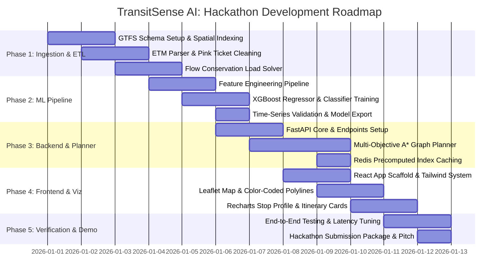

# TransitSense AI: Development Plan & Technical Roadmap
**Transport Stack Hackathon 2026 — Problem 2: Crowdedness-Aware Journey Planner**  
**Role:** Chief Software Architect & Technical Lead  
**Document Version:** 1.0.0  

---

## 1. Project Organization & Directory Structure

A clean, production-grade monorepo architecture separating frontend client, backend REST services, database migrations, and offline ML pipelines.

```
TransitSense-AI/
├── .github/
│   └── workflows/
│       ├── backend-ci.yml              # Python tests & linting
│       └── frontend-ci.yml             # TypeScript check & Vitest
├── backend/
│   ├── app/
│   │   ├── __init__.py
│   │   ├── main.py                     # FastAPI ASGI entrypoint
│   │   ├── config.py                   # Pydantic BaseSettings (DB, Redis, ML paths)
│   │   ├── api/
│   │   │   ├── __init__.py
│   │   │   ├── router.py               # Aggregated API v1 routers
│   │   │   ├── endpoints/
│   │   │   │   ├── health.py           # /health & /stats
│   │   │   │   ├── stops.py            # /stops search & nearby
│   │   │   │   ├── routes.py           # /routes metadata & polylines
│   │   │   │   ├── journey.py          # /journey/plan (A* Engine)
│   │   │   │   └── crowd.py            # /crowd predictions & heatmap
│   │   ├── core/
│   │   │   ├── exceptions.py           # Custom transit domain exceptions
│   │   │   ├── logging.py              # Structured JSON logging
│   │   │   └── security.py             # CORS & rate limiting middleware
│   │   ├── db/
│   │   │   ├── session.py              # SQLAlchemy 2.0 Async Session engine
│   │   │   └── base.py                 # Declarative model base
│   │   ├── models/                     # SQLAlchemy ORM definitions
│   │   │   ├── gtfs.py                 # Routes, Stops, Trips, StopTimes
│   │   │   ├── etm.py                  # Transactions & Occupancy aggregates
│   │   │   └── analytics.py            # Segment crowd & Stop index
│   │   ├── schemas/                    # Pydantic v2 validation models
│   │   │   ├── stop.py
│   │   │   ├── route.py
│   │   │   ├── journey.py              # Request/Response contracts
│   │   │   └── crowd.py
│   │   ├── services/                   # Business logic layer
│   │   │   ├── gtfs_service.py         # Network topology & graph loader
│   │   │   ├── journey_planner.py      # Multi-Objective A* / Dijkstra engine
│   │   │   ├── ml_service.py           # XGBoost inference server
│   │   │   └── analytics_service.py    # Stop & corridor metrics
│   │   └── utils/
│   │       ├── geo.py                  # Haversine & polyline utilities
│   │       └── time_utils.py           # Delhi IST time conversions
│   ├── tests/
│   │   ├── test_journey_planner.py
│   │   ├── test_ml_service.py
│   │   └── test_api_endpoints.py
│   ├── Dockerfile
│   └── requirements.txt
├── frontend/
│   ├── public/
│   │   ├── favicon.ico
│   │   └── markers/                    # Custom bus & stop pin icons
│   ├── src/
│   │   ├── App.tsx                     # Main layout & router
│   │   ├── main.tsx
│   │   ├── index.css                   # Tailwind CSS styling
│   │   ├── api/                        # Axios / Fetch client
│   │   │   ├── client.ts
│   │   │   ├── stopsApi.ts
│   │   │   ├── routesApi.ts
│   │   │   └── journeyApi.ts
│   │   ├── components/
│   │   │   ├── common/
│   │   │   │   ├── Badge.tsx           # Crowd tier indicators
│   │   │   │   ├── Loader.tsx
│   │   │   │   └── Modal.tsx
│   │   │   ├── map/
│   │   │   │   ├── TransitMap.tsx       # Leaflet Map container
│   │   │   │   ├── RoutePolyline.tsx    # Color-coded corridor overlays
│   │   │   │   ├── StopMarker.tsx
│   │   │   │   └── HeatmapLayer.tsx     # City-wide crowd visualization
│   │   │   ├── journey/
│   │   │   │   ├── SearchPanel.tsx      # Origin/Destination search
│   │   │   │   ├── PreferenceSlider.tsx # Comfort vs Speed controller
│   │   │   │   ├── ItineraryCard.tsx    # Side-by-side plan comparator
│   │   │   │   ├── LegTimeline.tsx      # Step-by-step transit itinerary
│   │   │   │   └── CrowdTag.tsx
│   │   │   └── analytics/
│   │   │       ├── StopCrowdChart.tsx   # Recharts 24-hr load curve
│   │   │       └── RouteStatsModal.tsx
│   │   ├── hooks/
│   │   │   ├── useJourneyPlan.ts
│   │   │   ├── useStopSearch.ts
│   │   │   └── useCrowdHeatmap.ts
│   │   ├── types/                      # TypeScript interfaces
│   │   │   ├── gtfs.ts
│   │   │   ├── journey.ts
│   │   │   └── crowd.ts
│   │   └── utils/
│   │       ├── crowdColors.ts          # Green/Yellow/Orange/Red theme tokens
│   │       └── formatters.ts           # Time & distance formatters
│   ├── package.json
│   ├── tsconfig.json
│   ├── tailwind.config.js
│   └── vite.config.ts
├── ml_pipeline/
│   ├── data/
│   │   ├── raw/                        # Original Delhi Transport Stack ETM CSVs
│   │   ├── gtfs/                       # Static Delhi GTFS feed files
│   │   └── processed/                  # Reconstructed loads & feature matrices
│   ├── notebooks/
│   │   ├── 01_eda_etm_patterns.ipynb   # Exploratory Analysis on Delhi ETMs
│   │   ├── 02_flow_reconstruction.ipynb# Boarding/Alighting reconciliation
│   │   └── 03_model_prototyping.ipynb  # Model benchmark & ablation
│   ├── src/
│   │   ├── __init__.py
│   │   ├── etl_gtfs_loader.py          # Ingest GTFS into PostgreSQL
│   │   ├── etl_etm_cleaner.py          # Clean ETM, handle Pink Passes
│   │   ├── flow_reconstructor.py       # Passenger conservation solver
│   │   ├── feature_engineering.py      # Generate 32-D feature vector
│   │   ├── train_xgboost.py            # Train Regressor & Classifier
│   │   ├── evaluate.py                 # Time-series validation & metrics
│   │   └── export_model.py             # Export Joblib / ONNX artifacts
│   ├── models/                         # Serialized model weights & metadata
│   │   ├── xgb_occupancy_regressor.joblib
│   │   ├── xgb_crowd_classifier.joblib
│   │   └── model_metadata.json
│   └── requirements-ml.txt
├── database/
│   ├── init_postgis.sql                # PostGIS initialization & spatial indexes
│   ├── schema.sql                      # Complete DDL tables & views
│   └── seed_sample_data.sql            # Core Delhi routes seed for rapid MVP boot
├── docker-compose.yml                  # Full stack: Postgres, Redis, Backend, Frontend
├── ARCHITECTURE.md                     # System architecture specification
├── DATABASE_SCHEMA.md                  # Relational & spatial schema
├── API_SPECIFICATION.md                # OpenAPI REST contract
├── ML_APPROACH.md                      # Data science formulation
└── README.md                           # Quickstart & local launch instructions
```

---

## 2. Frontend Modules Specification

The React + TypeScript + Tailwind frontend is structured into six high-cohesion modules:

### Module 1: Journey Search & Commuter Control Panel (`SearchPanel.tsx`)
- Geocoded autocomplete inputs for Origin and Destination (with Delhi landmark recognition: e.g., "Rajiv Chowk", "IIT Delhi", "Anand Vihar ISBT", "Saket").
- Departure time selector (presets for "Leave Now", "Morning Rush (09:00)", "Evening Rush (18:00)").
- **The Comfort vs. Speed Multi-State Controller (`PreferenceSlider.tsx`):**
  - Toggle modes: `Fastest Route` | `Balanced` | `Comfort First (Guaranteed Seat)`.
  - Explanatory commuter tooltip: *"Comfort First prioritizes buses with low occupancy, willing to add 5–10 minutes travel time to avoid crush loads."*

### Module 2: Interactive Leaflet Geospatial Canvas (`TransitMap.tsx`)
- Rendered on OpenStreetMap tiles with Delhi NCT bounding box clipping.
- Dynamic route polylines color-coded by crowdedness segment:
  - `Green (#10B981)`: Low ($\le 50\%$ capacity).
  - `Yellow (#F59E0B)`: Moderate ($51–80\%$).
  - `Orange (#F97316)`: High ($81–100\%$).
  - `Red (#EF4444)`: Crush Load ($>100\%$).
- Animated bus vehicle icons on active corridors.
- Interactive popups on stops showing real-time boarding count and predicted crowd status.

### Module 3: Itinerary Comparison & Decision Cards (`ItineraryCard.tsx`)
- Displays side-by-side alternative itineraries (e.g. Plan A: Fastest vs Plan B: Most Comfortable).
- Quantitative comfort indicators:
  - Expected seating probability percentage (e.g., $88\%$ vs $12\%$).
  - Visual crowdedness badge with explanatory text.
  - Total walk distance, transfer count, and estimated fare in INR.

### Module 4: Step-by-Step Leg Timeline & Stop Progression (`LegTimeline.tsx`)
- Vertical timeline detailing each transit leg (walking connection, boarding stop, in-vehicle transit, alighting stop).
- Collapsible intermediate stop list showing progressive passenger accumulation and stop-by-stop crowd level.

### Module 5: 24-Hour Stop Crowdedness Profile Drawer (`StopCrowdChart.tsx`)
- Built using **Recharts**.
- Dual-axis area/bar visualization showing hourly boardings vs. through-occupancy.
- Highlights Delhi rush-hour windows (08:00–11:00 and 17:30–20:30) with visual reference bands.

### Module 6: Network-Wide Crowdedness Heatmap Explorer (`HeatmapLayer.tsx`)
- Allows transport analysts and commuters to view an entire bird’s-eye snapshot of Delhi's arterial transit corridors (Ring Road, Outer Ring Road, Vikas Marg, Grand Trunk Road) at any selected hour of the day.

---

## 3. Development Roadmap & Phased Execution



### Detailed Phase Breakdown

#### Phase 1: Environment Setup, Data Ingestion & Flow Reconciliation (Sprint 1)
- Provision PostgreSQL 16 with PostGIS extension.
- Build automated parser for GTFS tables (`routes`, `stops`, `trips`, `stop_times`).
- Implement the Delhi ETM dataset cleaner:
  - Account for zero-fare Pink Tickets as full passenger boardings.
  - Filter corrupted transactions and map stage names to GTFS stop sequences.
- Implement the constrained quadratic optimization flow solver:
  $$L(s) = L(s-1) + B(s) - A(s)$$
  to reconstruct actual continuous loads across all trips in the 4–5 week dataset.

#### Phase 2: Feature Engineering & XGBoost Model Training (Sprint 2)
- Build feature extraction pipelines (cyclical time, holiday indicators, route stage progress, metro interchange flags, 4-week historical load lag).
- Perform strict Time-Series Block Split (Weeks 1–3 Train, Week 4 Validation, Week 5 Test).
- Train `XGBoostRegressor` (continuous load) and `XGBoostClassifier` (4 crowdedness tiers).
- Evaluate against baseline median lookup tables; generate ROC curves, confusion matrices, and feature importance charts.
- Export trained model artifacts (`.joblib` and metadata `.json`).

#### Phase 3: PostgreSQL Database Schema & FastAPI Backend Core (Sprint 3)
- Initialize database schema with partitioned transaction tables and PostGIS spatial indices.
- Implement FastAPI REST routes for `/health`, `/stops/search`, `/stops/nearby`, and `/routes/{id}`.
- Implement the `ml_service` wrapper to serve vectorized model predictions.
- Connect Redis for caching hourly stop index profiles.

#### Phase 4: Journey Planning Engine (Multi-Objective $A^*$) Integration (Sprint 4)
- Construct in-memory transit DAG representing Delhi bus schedules and walking transfers.
- Implement the parameterized multi-objective edge cost function:
  $$C(e) = w_{\text{time}} \cdot T(e) + w_{\text{crowd}} \cdot \Phi(\text{CrowdLevel}(e)) + w_{\text{trans}} \cdot I_{\text{trans}} + w_{\text{walk}} \cdot T_{\text{walk}}(e)$$
- Enable Pareto-optimal path selection to return both the "Fastest" route and the "Comfort First" route with explicit trade-off metrics.

#### Phase 5: Modern React Frontend, Leaflet Map & Recharts Analytics (Sprint 5)
- Scaffold Vite + React 18 + TypeScript + Tailwind CSS client.
- Implement `TransitMap` with Leaflet: render origin/destination markers, route geometries colored by crowdedness tier, and Delhi transit corridors.
- Build `ItineraryCard` with clear seating probability and crowdedness badges.
- Build `StopCrowdChart` using Recharts to visualize 24-hour temporal load curves with morning and evening peak bands.
- Integrate search autocomplete and preference toggles.

#### Phase 6: System Integration, Latency Profiling & Hackathon Demo (Sprint 6)
- Perform end-to-end integration tests: verify that routing requests yield authentic predictions based on Delhi ETM data.
- Optimize query performance (PostgreSQL indexes, Redis cache warm-up) to achieve $< 250\text{ms}$ overall journey response time.
- Conduct spot checks on known high-density Delhi corridors (e.g., Route 534 Anand Vihar to Mehrauli, Route 764 Najafgarh to Nehru Place) to confirm peak vs off-peak crowdedness fidelity.

---

## 4. Technical Risks & Data Limitations Analysis

| Risk & Data Limitation | Impact | Technical Root Cause | Architectural Mitigation Strategy |
| :--- | :---: | :--- | :--- |
| **Conductor Punching Delay** | Medium | ETM tickets are often punched 1–3 stops after passenger boarded due to conductor moving down the aisle. | Implement a 2-stop sliding window smoothing convolution during the flow reconstruction stage to redistribute boardings backward. |
| **Missing Explicit Alighting Records** | High | Flat-fare or stage tickets specify entry stage and fare amount, but not exact alighting stop ID. | Invert fare slabs (e.g. ₹5 $\le 4$km, ₹10 $4-10$km) to determine potential alighting stop ranges; calibrate using stage-based destination records. |
| **Pink Ticket Omission Risk** | Critical | Free passes for women have zero fare; naive pipelines dropping `fare == 0` lose 35–45% of ridership. | Hardcode ETL validation rule: ticket type `PINK_PASS` or zero fare on standard bus is strictly counted as 1 passenger boarding. |
| **Combinatorial Routing Explosion** | High | $A^*$ graph search over hundreds of routes and thousands of stops can cause high API latency. | Prune graph search using spatial bounding boxes (elliptical search space between origin and destination) + precomputed line connectivity. |
| **Data Sparsity on Feeder Routes** | Medium | Minor rural/feeder routes have fewer daily trips, risking high model variance. | Hierarchical fallback architecture: XGBoost $\to$ Historical Segment Median $\to$ Route Hourly Average $\to$ Global Network Prior. |
| **Vehicle Capacity Variance** | Low | Different bus models (Standard Floor 12m vs Low-Floor Electric 9m) have differing capacities (65 vs 46). | Store `bus_capacity` on the trip record and normalize target as `occupancy_ratio` rather than raw passenger count. |

---

## 5. Measurable Success Criteria & Hackathon Rubric Alignment

To guarantee a winning submission in Problem 2 of the Transport Stack Hackathon 2026, TransitSense AI is evaluated against rigorous, quantifiable criteria:

### 5.1 Machine Learning & Data Integrity Criteria
1. **Zero Data Fabrication Guarantee:** 100% of passenger load figures, historical profiles, and training samples are derived directly from the official Delhi Transport Stack ETM and GTFS records.
2. **Model Accuracy:**
   - XGBoost Regressor achieves $\text{MAE} \le 5.5$ passengers across the out-of-time test week (Week 5).
   - XGBoost Classifier achieves Macro $F_1 \ge 0.78$ and Peak-Hour Accuracy $\ge 82\%$.
3. **Safety Metric (False-Low Rate):**
   - The probability of predicting "Low Crowdedness (Green)" when the actual bus is at "Crush Load (Red)" must be $< 4.0\%$.

### 5.2 Journey Planning & Performance Criteria
1. **End-to-End API Latency:**
   - Multi-objective journey planning response time $\le 250\text{ms}$ at 95th percentile.
   - Stop crowd profile retrieval $\le 35\text{ms}$.
2. **Crowd Differentiation:**
   - When the user selects "Comfort First", the planner successfully diverts to an alternative route or schedule with $\ge 40\%$ lower crowdedness whenever the primary direct route is in Crush Load.
3. **Plausibility & Spot-Check Alignment:**
   - Spot-checking major hubs (Kashmere Gate, Nehru Place, Dhaula Kuan) during 08:30–10:00 must correctly reflect High/Crush load tiers.

### 5.3 User Experience & Presentation Criteria
1. **Intuitive Visual Hierarchy:** Color-coded polylines on Leaflet map immediately convey crowding conditions at a glance.
2. **Actionable Decision Support:** Itinerary cards clearly present the trade-off (e.g., *"Adds 6 mins, but 85% chance of a seat"*).
3. **Responsive Execution:** Fully operational on standard modern browsers with zero external paid API dependencies.
