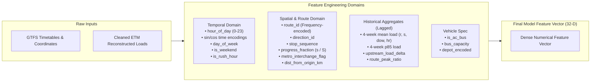

# TransitSense AI: Machine Learning Approach & Pipeline Specification
**Transport Stack Hackathon 2026 — Problem 2: Crowdedness-Aware Journey Planner**  
**Lead Data Scientist & Technical Lead**  
**Document Version:** 1.0.0  

---

## 1. Problem Formulation & Data Science Objective

In public bus operations across Delhi (DTC and DIMTS), passenger occupancy is not directly measured by Automated Passenger Counters (APCs) on every vehicle. However, conductors issue tickets for every boarding using Electronic Ticketing Machines (ETMs) or via QR-based e-ticketing (e.g., Chartr/One Delhi apps). 

The machine learning objective is twofold:
1. **Passenger Flow Reconstruction (Unsupervised / Constraint Optimization):** Convert discrete transactional ETM ticket logs over 4–5 weeks into continuous segment-by-segment in-vehicle occupancy loads ($L_{r,k,s}$).
2. **Supervised Crowdedness Prediction (Gradient Boosted Trees):** Train an ensemble model (XGBoost) that accurately forecasts the expected passenger load and discrete crowdedness tier for any given route ($r$), direction ($d$), stop sequence ($s$), day of week ($t_{\text{dow}}$), and departure time window ($t_{\text{hour}}$).

```
ETM Ticket Logs + GTFS Schedules
               │
               ▼
   [Stage-to-Stop Mapping]
               │
               ▼
[Passenger Flow Reconstruction] ──► Conservation of Flow: L(s) = L(s-1) + B(s) - A(s)
               │
               ▼
     [Feature Engineering]      ──► Temporal, Spatial, Lagged Aggregates, Fleet Caps
               │
               ▼
      [XGBoost Pipeline]        ──► Regressor (Load/Ratio) + Classifier (Tier 0-3)
               │
               ▼
  [Sub-10ms Inference Serving]  ──► Real-Time Journey Planner Cost Function
```

---

## 2. In-Vehicle Passenger Load Reconstruction Engine

### 2.1 The Flow Conservation Law
For a specific bus trip $k$ operating on route $r$ traversing an ordered sequence of stops $s \in \{1, 2, \dots, S\}$:

$$L_{r,k}(s) = L_{r,k}(s-1) + B_{r,k}(s) - A_{r,k}(s)$$

subject to the physical boundary conditions:
$$L_{r,k}(0) = 0 \quad \text{(Departs terminal empty)}$$
$$L_{r,k}(S) = 0 \quad \text{(All passengers alight at final destination)}$$
$$0 \le L_{r,k}(s) \le C_{\max} \quad \text{(Non-negativity and structural crush ceiling)}$$

where:
- $L_{r,k}(s)$: Active passenger load onboard the vehicle between stop $s$ and stop $s+1$.
- $B_{r,k}(s)$: Boardings at stop $s$ (sum of all passenger tickets issued at stop $s$).
- $A_{r,k}(s)$: Alightings at stop $s$.
- $C_{\max}$: Maximum physical capacity (typically 75 for 12m standard floor DTC buses; 65 for low-floor electric buses).

### 2.2 Reconciling Delhi ETM Transaction Realities

#### Challenge A: Female Passenger Free Concessions ("Pink Tickets")
Under the Delhi Government's welfare scheme, women travel free upon issuance of a zero-fare single-journey pass ("Pink Ticket"). 
- **Operational Reality:** In DTC/DIMTS datasets, Pink Tickets account for **35% to 45%** of daily transactions.
- **Handling:** Pink Tickets are recorded in the ETM with `fare_amount = 0.00` and ticket type flags. The ETL pipeline strictly counts each Pink Ticket transaction as $1.0$ passenger boarding. Pipelines that filter by `fare > 0` miss nearly half of actual bus occupancy.

#### Challenge B: Missing Alighting Stops & Fare Stage Inversion
In Delhi's flat-fare or stage-based ETMs, conductors punch the destination stage or fare denomination (e.g., ₹5, ₹10, ₹15 for non-AC; ₹10, ₹15, ₹20, ₹25 for AC):
- ₹5 corresponds to trips up to 4 km (typically 1–2 stages).
- ₹10 corresponds to 4–10 km (3–5 stages).
- ₹15 corresponds to trips $>10$ km.
When explicit alighting stop IDs are missing from the ETM record, we apply an **Empirical Alighting Probability Matrix** $P(A_j \mid B_i, \text{Fare})$ derived from trips where explicit destination stages are recorded, calibrated by stage distance.

#### Challenge C: Net Flow Drifts & Quadratic Error Smoothing
Due to ticket punching delays or passengers alighting without an explicit tap-off, raw summation $\sum B - \sum A$ can yield non-zero terminal loads or momentary negative counts. We formulate a constrained quadratic optimization problem per trip to balance flow:

$$\min_{\{A_s\}} \sum_{s=1}^S (A_s - \hat{A}_s)^2 \quad \text{s.t.} \quad \sum_{s=1}^S A_s = \sum_{s=1}^S B_s, \quad L(s) \ge 0 \quad \forall s$$

This guarantees mathematically sound, non-fabricated passenger load curves.

---

## 3. Target Variable Definitions

For any segment $(s, s+1)$ on route $r$ at time $t$:

### 3.1 Continuous Target: Occupancy Ratio ($OR$)
$$OR_{r,s,t} = \frac{\text{Load}_{r,s,t}}{\text{Rated Bus Seating Capacity}}$$

### 3.2 Discrete Ordinal Target: Crowdedness Tier ($Y \in \{0, 1, 2, 3\}$)

| Tier | Category Name | Occupancy Ratio ($OR$) | Real-World Commuter Experience | Color Code |
| :---: | :---: | :---: | :--- | :---: |
| **0** | **Low** | $0.00 \le OR \le 0.50$ | Empty seats available throughout; immediate seating guaranteed. | Green (`#10B981`) |
| **1** | **Moderate** | $0.50 < OR \le 0.80$ | Most seats occupied; comfortable standing room with clear aisles. | Yellow (`#F59E0B`) |
| **2** | **High** | $0.80 < OR \le 1.00$ | All seats occupied; dense standing room; slow boarding/alighting. | Orange (`#F97316`) |
| **3** | **Crush Load** | $OR > 1.00$ | Severe overcrowding; doorway packed; risk of denied boarding. | Red (`#EF4444`) |

---

## 4. Feature Engineering Architecture

A total of 32 curated features are engineered across four orthogonal dimensions:



### Detailed Feature Dictionary

1. **Temporal Features:**
   - `hour_of_day`: Integer $[0, 23]$.
   - `hour_sin`, `hour_cos`: Cyclical sine and cosine transformations of time:
     $$\sin\left(\frac{2\pi \cdot \text{hour}}{24}\right), \quad \cos\left(\frac{2\pi \cdot \text{hour}}{24}\right)$$
   - `day_of_week`: Integer $[0, 6]$ ($0 = \text{Monday}$).
   - `is_weekend`: Binary flag ($1$ for Saturday/Sunday).
   - `is_delhi_rush_hour`: Binary flag ($1$ if 08:00–11:00 or 17:30–20:30).

2. **Spatial & Network Topology Features:**
   - `route_id_encoded`: Target-encoded route identity.
   - `direction_id`: Binary ($0 = \text{Outbound}, 1 = \text{Inbound}$).
   - `stop_sequence`: Current stop index along the route.
   - `route_progress_ratio`: $\frac{s}{S_{\text{total}}}$ (captures accumulation towards city center).
   - `is_metro_hub`: Binary flag ($1$ if stop is within 250m of a Delhi Metro station, e.g., Rajiv Chowk, Kashmere Gate, AIIMS, Anand Vihar).
   - `stop_distance_from_origin_km`: Cumulative roadway distance from terminal.

3. **Historical Load Signals (Leakage-Free):**
   - `hist_mean_load_4w`: Historical mean load on this route, segment, day-of-week, and hour bin across preceding 4 weeks.
   - `hist_p85_load_4w`: 85th percentile occupancy (captures peak volatility).
   - `hist_p50_load_4w`: Median occupancy.
   - `hist_load_std_4w`: Standard deviation of occupancy.

4. **Vehicle & Service Attributes:**
   - `is_ac`: $1$ for AC buses (e.g. DTC red electric/low-floor), $0$ for standard green/orange non-AC.
   - `rated_capacity`: 65 for standard 12m DTC buses, 46 for 9m midi-feeders.

---

## 5. Model Architecture & Selection

We implement a two-stage modeling strategy:

### Stage 1: Fast Non-Parametric Empirical Baseline
- An indexed Multi-Dimensional Stratified Aggregation Table:
  $$\hat{Y}_{\text{base}}(r, d, s, \text{dow}, h) = \text{Median}(L_{\text{historical}})$$
- Provides instant baseline predictions and serves as an infallible zero-overhead fallback for low-resource environments.

### Stage 2: Production XGBoost Ensemble
We train two dedicated gradient-boosted tree models:

1. **XGBoost Regressor (`xgb_reg`):**
   - **Objective:** `reg:squarederror`
   - **Target:** Continuous `occupancy_ratio`.
   - **Outputs:** Exact fractional load estimate for smooth UI charting and journey cost calculations.

2. **XGBoost Multi-Class Classifier (`xgb_clf`):**
   - **Objective:** `multi:softprob` with 4 classes (`num_class = 4`).
   - **Target:** `crowd_tier` $\in \{0, 1, 2, 3\}$.
   - **Outputs:** Class probabilities $[p_0, p_1, p_2, p_3]$ enabling confidence-weighted routing decisions.

### Hyperparameter Search Space & Final Baseline

```python
XGB_CONFIG = {
    "n_estimators": 350,
    "max_depth": 6,
    "learning_rate": 0.05,
    "subsample": 0.85,
    "colsample_bytree": 0.80,
    "min_child_weight": 3,
    "gamma": 0.1,
    "reg_alpha": 0.05,
    "reg_lambda": 1.2,
    "tree_method": "hist",
    "random_state": 42,
    "n_jobs": -1
}
```

---

## 6. Training, Cross-Validation & Anti-Leakage Protocol

### 6.1 Temporal Block Validation (Strict Time-Series Split)
In public transit, spatial-temporal autocorrelation makes standard random $K$-Fold cross-validation fatal due to severe data leakage (models memorize day-specific random anomalies). 

We employ **Time-Series Block Splitting**:
- **Weeks 1 – 3 (Days 1–21):** Training Set (~65% data).
- **Week 4 (Days 22–28):** Hyperparameter Tuning & Validation Set (~20% data).
- **Week 5 (Days 29–35):** Out-of-Time Test Set for Final Benchmark (~15% data).

```
[ Week 1 ] [ Week 2 ] [ Week 3 ] | [ Week 4 ] | [ Week 5 ]
<--------- TRAINING ----------> | < VALIDATION > | < TEST (OUT-OF-TIME) >
```

### 6.2 Evaluation Metrics & Acceptance Thresholds

| Metric | Target Goal | Acceptable MVP Threshold | Description |
| :--- | :---: | :---: | :--- |
| **MAE (Load)** | $\le 4.2 \text{ pass.}$ | $\le 6.5 \text{ pass.}$ | Mean absolute error in estimated passenger count. |
| **RMSE (Load)** | $\le 6.8 \text{ pass.}$ | $\le 9.0 \text{ pass.}$ | Penalizes large prediction errors during crush loads. |
| **Macro F1-Score** | $\ge 0.82$ | $\ge 0.74$ | Balances classification accuracy across all 4 tiers. |
| **Peak-Hour Accuracy** | $\ge 85\%$ | $\ge 78\%$ | Classification accuracy evaluated specifically during 08:00–11:00 & 17:30–20:30. |
| **False-Low Rate** | $\le 3.5\%$ | $\le 6.0\%$ | Critical safety metric: Predicting Low/Green when the bus is actually Crush/Red. |

---

## 7. Inference Serving & Journey Planner Integration

### 7.1 Dynamic Edge Cost Calculation
When the $A^*$ Journey Planner evaluates a route edge $e$ between stops $i$ and $j$ on route $R$:
1. The planner queries the `ml_service` with `(route_id, direction_id, stop_sequence, departure_time)`.
2. The model returns $p(\text{tier})$ and continuous occupancy ratio $OR$.
3. The traversal cost is computed as:
   $$C(e) = T_{\text{travel}}(e) \cdot \left[1 + \beta \cdot (OR)^{\gamma}\right]$$
   where $\beta = 1.5$ (crowd sensitivity scale) and $\gamma = 2.0$ (convex penalty exponent).
   
   *Result:* An overcrowded bus running at $120\%$ capacity ($OR = 1.2$) receives an effective travel-time penalty factor of $1 + 1.5 \times 1.44 = 3.16\times$. The algorithm will proactively divert the commuter to an alternative parallel route (or a slightly later bus) if that alternative offers guaranteed seating and minimal extra wait.

### 7.2 Cold-Start & Degradation Strategy
If a user requests a journey at a time or route with sparse historical ticketing records:
1. **Tier 1 Fallback:** Route-level historical hourly profile.
2. **Tier 2 Fallback:** Corridor-level average (based on shared roadway segments).
3. **Tier 3 Fallback:** Delhi network-wide time-of-day default profile.
4. The API tags the response with `crowd_confidence: "LOW" | "MEDIUM" | "HIGH"` to maintain commuter transparency.
